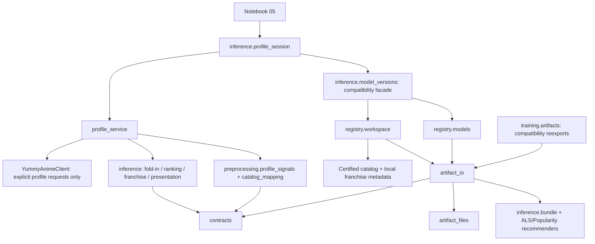

# ARE-009C — Contracts, Artifact I/O and Local Model Registry

Продолжение миграции: [ARE-009D](ARE-009D-independent-pipelines.md) разделяет
TrainView/ValidationView и независимые operations, устраняет описанный ниже legacy
scaling cycle. Этот документ сохраняет срез ARE-009C.

Дата: 24 ноября 2026. Статус: принят, подготовлен к публикации после integration review.
Baseline: [ARE-009B](ARE-009B-compatibility-baseline.md). Исторический аудит
ARE-009A сохранён отдельно в локальном рабочем дереве.

## Границы модулей

| Модуль в `src/anime_recommender/` | Ответственность |
| --- | --- |
| `contracts.py` | ModelIdentity, ModelMetadata, ItemMapping/Fingerprint aliases, InferenceModel Protocol, ModelBundle/ModelWorkspace records, RecommendationResult и общие инварианты IDs/mapping/factors. Нет imports stages или pipeline runners. |
| `artifact_files.py` | SHA-256 файлов и прежние atomic JSON/Parquet helpers; без ML backend и ingestion. |
| `artifact_io.py` | Format v1, checksum/schema/fingerprint validation, native ALS loading и immutable publication. |
| `registry/models.py` | Чтение конфигурации, lookup alias/model ID, metadata, availability, compatibility и загрузка bundle. |
| `registry/workspace.py` | Saved bundle, сертифицированный display catalog и локальные franchise metadata. Без interaction datasets и validation. |
| `inference/bundle.py` | Factory ALS/Popularity recommenders поверх нейтрального bundle record. |
| `inference/presentation.py` | Названия и display tables. |
| `preprocessing/catalog_mapping.py` | Существующее сопоставление пользовательского MAL ID с vocabulary, вынесенное из evaluation. |
| `profile_service.py` | Получение профиля явным вызовом, нормализация, fold-in/recommendation orchestration, title enrichment. Не импортирует training/evaluation/research facade. |
| `inference/profile_session.py` | Сессионный cache источника по nickname и model-specific производных; переключение моделей без повторного получения профиля. |



Inference entrypoints `inference.model_versions`, `inference.profile_session`,
`registry.models`, `artifact_io` не импортируют project training/evaluation модули,
включая транзитивные зависимости. Native `implicit` загружается для декодирования
ALS и fold-in; это не импорт нашего training pipeline. Model loading читает только
готовые bundle files. Workspace дополнительно читает каталог и локальные metadata.
HTTP разрешён только отдельным явным методам работы с профилем, не model load.

## Совместимый artifact format

Сохраняется **format_version = 1**, без миграции существующих файлов:

```text
bundle/
  als.npz
  item_mapping.parquet
  train_user_mapping.parquet
  popularity.parquet
  training_config.json
  metadata.json
```

Metadata содержит training_config, dataset_config, train_fingerprint,
mapping_fingerprint и files_sha256 остальных пяти файлов. `model_version`
необязателен у legacy ARE-006 bundle. Mapping columns остаются
`dataset_anime_id`, `myanimelist_id`, `matrix_col`: уникальные положительные IDs,
упорядоченные непрерывные matrix columns. Формула mapping fingerprint и все
JSON/Parquet serialization параметры сохранены. Training fingerprint — прежний
opaque идентификатор; reader не вычисляет его из interactions и не читает dataset.

Reader проверяет полные шесть файлов, schema version, manifest/checksums,
согласованность конфигурации, mapping fingerprint, ожидаемые mapping/train
fingerprints при передаче caller/registry, dimensions/finite factors, ALS
parameters и popularity alignment. Ошибки: FileNotFoundError для неполного
bundle, DataValidationError для несовместимости/повреждения. Неподдерживаемая
schema отвергается явно. Checksums обеспечивают целостность, не аутентичность
источника; metadata не содержит отдельной криптографической подписи.

## Registry configuration и model loading

Текущий `configs/model_versions.json` не изменён: default **10k**, aliases
**1k/5k/10k**, прежние paths. `schema_version` опционален, отсутствие означает 1.
Ни сортировка версий, ни новый entry не переключают default автоматически.

Для добавления, например, 20k достаточно нового entry в `versions`:

```json
"20k": {
  "model_id": "als-20k",
  "model_dir": "artifacts/models/scaling/20k",
  "dataset_dir": "data/processed/scaling/20k",
  "train_fingerprint": "<expected train fingerprint>",
  "mapping_fingerprint": "<expected mapping fingerprint>"
}
```

Это пример конфигурации, не реально обученная/зарегистрированная 20k модель.
`dataset_dir` необязателен и не читается registry. `model_id` по умолчанию равен
alias; IDs уникальны и не могут конфликтовать с другим alias. `model_type` v1 —
`als`: bundle содержит ALS и Popularity. Если физический metadata.model_version
отличается от alias, можно явно указать `artifact_version`; отсутствие версии в
legacy metadata допустимо без переписывания файлов. Optional fingerprints
позволяют зафиксировать внешний ожидаемый identity сверх внутренних checksums.
Model paths ограничены `artifacts/models/`, dataset paths — `data/` проекта.

```python
from anime_recommender.registry.models import ModelRegistry

registry = ModelRegistry(project_root)
records = registry.list_models()       # configured entries, включая отсутствующие
record = registry.get("10k")          # identity, path, available, metadata
metadata = registry.get_metadata("10k")
bundle = registry.load()               # explicit configured default: 10k
checked = registry.verify("5k")        # полная проверка через reader
```

`is_available()` проверяет наличие файлов; `get_metadata()` проверяет schema,
но не декодирует/не хеширует весь bundle. Для полной проверки — `verify/load`.
Отсутствующая модель даёт понятную ошибку без скрытого fallback на другую версию.
Bundle не скачивается и не обучается. Binary artifacts не хранятся в Git;
инструкции локального воспроизведения ARE-008 в README остаются действующими.

Notebook 05 сохраняет прежний API через `inference.model_versions` и
ProfileSession. По умолчанию 10k/top_k=15. Source profile хранится только в памяти,
один источник используется при 1k → 10k → 5k → 1k. Каталоги mappings и model
factors загружаются соответствующей версии; scores не преобразуются. Known-item
exclusion и локальный franchise postprocessing сохранены.

## Immutable publication

`artifact_io.save_models(bundle, new_directory)`:

1. Отвергает существующий target, включая пустой каталог и ту же самую модель.
2. Создаёт sibling lock через `O_CREAT | O_EXCL`, записывает PID, fsync lock.
3. Повторно проверяет target под lock.
4. Записывает в уникальный sibling staging на том же filesystem. Metadata
   копируется, completion metadata записывается последним.
5. Полностью загружает и валидирует staging через тот же `load_models`.
6. Атомарно публикует **без замены**: Windows `os.rename`; Linux
   `renameat2(RENAME_NOREPLACE)`. Unsupported platform/filesystem — отказ,
   без небезопасного fallback. Это защищает и от создания target вне lock.
7. После успеха обновляет metadata caller прежними вычисленными hashes;
   при ошибке caller metadata не меняется. Удаляет lock и staging при обычных
   ошибках и KeyboardInterrupt.

Конкурентный writer получает FileExistsError: ожидания и overwrite нет. После
жёсткого завершения процесса могут остаться lock/staging; их требуется проверить
и убрать вручную после подтверждения отсутствия активного publisher. Автоматически
признавать lock устаревшим небезопасно. Atomic visibility не означает гарантию
durability после отключения питания; network/distributed filesystems не заявлены.
Для новой публикации следует выбирать новый directory/version.

В scaling runner изменён только вызов writer: прежний внешний staging удалён,
поскольку теперь staging/validation/publication принадлежат Artifact I/O. Existing
baseline/5k/10k не перезаписывались.

## Compatibility adapters и оставшийся legacy

- `training.artifacts`: reexports ModelBundle/load_models/save_models/
  mapping_fingerprint; старые импорты сохраняются.
- Старые DataValidationError, mapping/factor validators, RecommendationResult и
  file helpers переэкспортированы по прежним путям.
- `evaluation.training_data.map_user_to_training` — alias нейтрального для stages
  preprocessing helper, без изменения MAL semantics.
- `recommendation_exploration` сохраняет публичные research APIs и тонкие profile/
  workspace adapters. Training/evaluation imports отложены до явного research
  вызова. Serving не использует этот facade для бизнес-логики; Notebook 05 ещё
  импортирует оттуда прежний display adapter.
- Адаптеры сохраняются на период ARE-009D/E. Удаление — только отдельным review
  после миграции всех callers, не автоматически в следующем этапе.

TrainView/ValidationView, research runners и historical Full/Warm протоколы не
реорганизованы. Общий исторический deferred-import cycle
`training.scaling.main → ingestion.scaling → training.scaling` остаётся вне
serving dependency closure. Тест отсутствия циклов охватывает все project imports,
включая deferred, достижимые из новых serving entrypoints; он не объявляет весь
legacy repository ацикличным. Декомпозиция runners относится к ARE-009D/E.
Workspace ещё использует общий certified catalog config ARE-006; registry не
становится dataset registry. Pickle serialization Python objects не является
публичным bundle format; поддерживается существующий native NPZ/Parquet/JSON.

## Проверки

- Fresh interpreter с запрещёнными training/evaluation/research imports,
  HTTP и fit: import serving и read-only load доступных локальных 1k/5k/10k.
- Synthetic registry 1k/5k/10k/20k без fit и дополнительных данных; lookup,
  default, missing, legacy metadata, несовместимые fingerprints.
- Writer: reload predictions, repeated publication, corrupt/incomplete payload,
  interruption, stale lock, destination race и два отдельных publisher processes.
- ARE-009B saved validation replay: exact IDs/ranks, scores atol=1e-6/rtol=1e-5,
  metrics atol=rtol=1e-10. Historical metrics не изменяются.
- Notebook 05: synthetic profile, real saved models, переходы всех версий,
  network/fit/ingestion/dataset rebuild и чтение interactions/test запрещены;
  выполнение в памяти, без сохранения outputs.
- Integration tests явно skip при отсутствии необязательных локальных artifacts
  на чистом clone; синтетические тесты не требуют downloads.

Результат полного `pytest -q -p no:cacheprovider`: **221 passed**, 30.68 s,
без skips. Два предупреждения окружения: OpenBLAS thread count в синтетическом
fixture и Windows Jupyter Proactor/zmq. После удаления неиспользуемых imports
адресно повторены 33 tests — passed.

Дополнительное read-only сравнение с исходным `recommendation_exploration` из
Git HEAD на синтетическом профиле подтвердило прежние Top-15, ranks, scores и
fallback для 1k → 10k → 5k → 1k. Reference source выполнялся только в памяти,
HTTP/fit были запрещены; файлы моделей не изменялись.

Снимок SHA-256 до/после: все **254** защищённых файла в data/artifacts/configs/
notebooks совпали, включая Notebook 01 и 05. Изменённые текстовые файлы проверены
на совпадения с секретными значениями локального .env — совпадений нет.
Staged files отсутствуют; commit/push не выполнялись. Следующий этап не начат.
