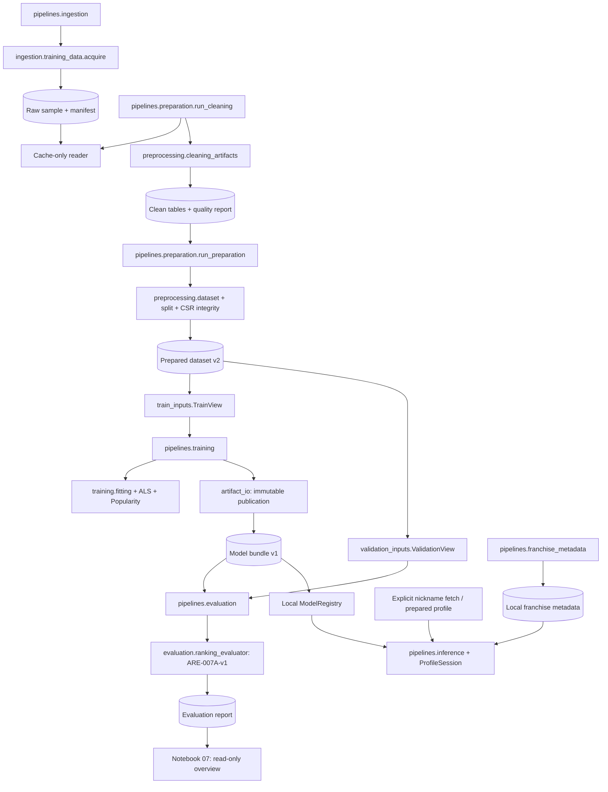

# ARE-009D — Independent ML Pipelines & Execution Boundaries

Дата: 24 ноября 2026. Статус: принят, подготовлен к публикации после integration review.
Основа: [ARE-009B](ARE-009B-compatibility-baseline.md),
[ARE-009C](ARE-009C-contracts-and-registry.md).

## Границы и направление зависимостей

`pipelines/` содержит явную оркестрацию; алгоритмы остаются в preprocessing,
training, evaluation и inference. Импорт pipeline ничего не исполняет.
Новые операции не вызывают следующий этап автоматически.



Training не импортирует ValidationView, evaluation, ingestion или combined
experiment runner. Evaluation не импортирует training package и не требует train
CSR/interactions. Inference сохраняет границы ARE-009C: saved model, display
catalog, подготовленные локальные franchise metadata и профиль в памяти.

### Минимальные views

- `TrainView`: train positives, train_user_mapping, item_mapping, CSR,
  dataset config, прежний train fingerprint/hashes и catalog identity.
  Reader проверяет только четыре train files. Validation/test могут отсутствовать.
  Positives нужны Popularity; user mapping связывает строки ALS с train IDs.
- `ValidationView`: positive context/targets, all-observed context, validation
  users; vocabulary и train-user IDs берутся из готовой модели, config и
  identity — из dataset manifest. Reader не открывает train artifacts или test.
  Для проверок user leakage используются IDs из bundle, а не train interactions.
- `dataset_artifacts.py`: selective checksum reader, baseline/shared references и
  прежняя формула training identity. Для validation train fingerprint вычисляется
  по записанным train hashes/config; это не повторная проверка физических train
  файлов. Их целостность проверяется producer/train reader, bundle — Artifact I/O.
- `research_inputs.py`: совместимый объединённый research view. Не является
  входным контрактом независимого training/evaluation runner.

Формула fingerprints, split, raw holdout before positive filtering, threshold=5,
train minima=5/5, CSR orientation и ML-алгоритмы не менялись. Validation сохраняет
cold targets, пользователей без warm context и без positive targets. Canonical
Warm eligibility — **ARE-007A-v1**, без условия наличия warm context. Исторический
legacy evaluator остаётся доступен с прежним eligibility.

## Pipeline input/output contracts

| Операция | Явный вход | Выход / effects | Чего не делает |
| --- | --- | --- | --- |
| `run_ingestion` | pinned source config, root, execute, allow_network | plan либо raw directory/verified manifest; reuse cache | Не очищает, не делит, не обучает |
| `run_cleaning` | существующий raw cache, source/cleaning config | Clean Parquet + ARE-004 quality report | Не вызывает acquire/download |
| `run_preparation` | сертифицированные clean tables, split config | PreparedDataset v2, splits, vocabulary, CSR, report | Не загружает raw из сети и не обучает |
| `run_training` | готовый train directory, training config, новый model output | plan либо ALS/Popularity bundle с fit statistics | Не требует validation и не запускает evaluation |
| `run_evaluation` | готовый model directory, validation directory, config, optional output | canonical EvaluationReport; optional new persisted report | Не fit, не ingestion, не test |
| `create_session` / `recommend_profile` | root/version/K, nickname или нормализованная history | Top-N, titles/scores/diagnostics, in-memory source cache | Не train/evaluate/discover metadata |
| `run_franchise_metadata` | local vocabulary/config, execute, allow_network, budget | dry-run либо versioned metadata/coverage/checkpoint | Не ALS training/inference |

У training/ingestion execute=False по умолчанию. Network требует отдельного
allow_network=True. Metadata сохраняет прежний request budget и дополнительный
guard больших запусков. Никакие сетевые операции или реальные ML-эксперименты
в рамках этой миграции не запускались.

## Независимый запуск через Python API

Пути в примерах относительны project root. Configs читаются явно; пример training
показывает новый output, а не перезапись существующей default модели.

```python
import json
from pathlib import Path

root = Path.cwd()
source = json.loads((root / "configs/training_data.json").read_text())
split = json.loads((root / "configs/ml_dataset.json").read_text())
training = json.loads((root / "configs/recommendation_models.json").read_text())

# A: по умолчанию plan или проверенный reuse. Никаких следующих stages.
from anime_recommender.pipelines.ingestion import run_ingestion
raw = run_ingestion(source, root)
# Только при отдельно разрешённой загрузке:
# raw = run_ingestion(source, root, execute=True, allow_network=True)

# B: две независимые локальные операции; для новых snapshots задайте новые dirs.
from anime_recommender.pipelines.preparation import run_cleaning, run_preparation
quality = run_cleaning(source, root)
prepared = run_preparation(split, root)

# C: можно передать directory, содержащий только manifest и train files.
from anime_recommender.pipelines.training import run_training
plan = run_training(root / training["dataset_dir"], training,
                    root / "artifacts/models/new-reviewed-version")
# Только явный вызов обучает и публикует новый bundle:
# bundle = run_training(root / training["dataset_dir"], training,
#                       root / "artifacts/models/new-reviewed-version", execute=True)

# D: saved 10k, фиксированная validation; обучение не запускается.
from anime_recommender.pipelines.evaluation import run_evaluation
report = run_evaluation(root / "artifacts/models/are008b/10k",
                       root / "data/processed/scaling/sample_10000",
                       {"split": "validation", "ks": [10], "include_als_fallback": False})
# output_dir=новый_каталог включает публикацию отчёта; None оставляет его в памяти.

# E: сессия создаётся без сети; nickname request — явное действие пользователя.
from anime_recommender.pipelines.inference import create_session, recommend_profile
session = create_session(root)
# result = session.recommend(nickname, model_version="10k", top_k=15)
# result = session.recommend(nickname, model_version="5k", top_k=15)  # source cache
# Уже подготовленный fetched_history: {"history": normalized_frame, "requests": frame}
# result = recommend_profile(root, fetched_history, model_version="10k", top_k=15)

# F: dry-run; никакой online discovery во время E.
from anime_recommender.pipelines.franchise_metadata import run_franchise_metadata
metadata_plan = run_franchise_metadata(root)
```

Config служит identity артефакта; существующий processed/split output переиспользуется
только после проверки hashes и совпадения config/source. Несовпадение требует нового
пути. Model output должен отсутствовать даже при повторной записи той же модели;
для reuse используйте Registry/Artifact I/O. Новый default не выбирается автоматически.

## Artifact producer/consumer matrix и lifecycle

| Artifact | Producer → Consumer | Schema / fingerprint | Storage / reuse / overwrite |
| --- | --- | --- | --- |
| Raw sample | ingestion → cleaning | sampling_version sha256-bottom-k-complete-users-v1; source revision/bytes/SHA + parameters + cache_sha256 | data/raw; verified matching cache reused, mismatch rejected; новый cache_dir для другой выборки |
| Clean tables/catalog | cleaning → preparation / display workspace | ARE-004 pipeline_version1; output_sha256 + config/provenance | data/processed; immutable publication нового output, verified reuse идентичного snapshot |
| Train/validation/test | preparation → selective views / integrity audit | dataset_version2; config/source_sha256/artifact_sha256; train fingerprint неизменной формулы | data/processed/ml или scaling/*; immutable new output, matching reuse; test не читается ranking evaluation |
| Model bundle | training → Registry / evaluation / inference | format_version1, files_sha256, mapping/train fingerprints | artifacts/models; ARE-009C lock/staging/no-replace publication; никакого overwrite |
| Registry | explicit config edit → load-only consumers | optional schema_version1, aliases/model IDs, optional expected fingerprints | configs/model_versions.json; controlled configuration, default10k; регистрация отдельно от fit |
| Evaluation report | evaluation → inspection / Notebook07 | ARE-007A-v1, model/dataset fingerprints, Parquet+JSON manifest SHA | artifacts/evaluation; optional new immutable output, saved historical reports не изменяются |
| Franchise metadata | explicit metadata update → local inference filter | versioned manifest/source records/mapping/coverage fingerprints; checkpoint schema1 | data/processed/franchises; существующие checkpoint/resume/TTL/retry policies, new snapshot и latest pointer |

Model publication использует прежний безопасный protocol ARE-009C. Atomic
no-replace directory primitive перенесён в `artifact_files.publish_directory`,
чтобы data/report writers не импортировали ML backend. Cleaning/preparation/report
записываются в sibling staging, проверяются и публикуются без замены target.
Два writers могут независимо подготовить staging, но опубликовать один target
сможет только один; другой получает FileExistsError. После обычных exceptions
staging удаляется. Hard kill может оставить staging; automatic cleanup не добавлен.
Windows/Linux local filesystem support и ограничения durability прежние.

Raw acquisition и metadata checkpoint используют свои прежние verified-cache и
resume contracts; distributed transactions и новый workflow framework не добавлены.

## Совместимость и устранённые связи

- `training.dataset` переэкспортирует `preprocessing.dataset`; математические
  функции и serializer не переписаны. Integrity checks перенесены из
  `evaluation.dataset_validation` в `preprocessing.dataset_validation` с alias.
- `training.scaling` переэкспортирует локальную подготовку из preprocessing.
  Старый combined scaling workflow находится в `pipelines.scaling`;
  `ingestion.scaling.run_scaling` — compatibility adapter с прежними параметрами.
  Стрелка обратно из preparation в ingestion runner отсутствует: исходный
  deferred cycle устранён по ответственности, не переносом import внутрь функции.
- `training.fitting` содержит прежний train-only fit_models. Независимый runner
  не импортирует legacy experiment. `training.pipeline.run_experiment` сохранён
  как **явно combined legacy research API** с прежними fit+diagnostic effects.
  Его реализация находится в pipelines/legacy_experiment; новый code должен
  явно вызывать training и evaluation отдельно. Это compatibility exception,
  не рекомендуемый интерфейс отдельного training stage.
  Diagnostic metadata enrichment остаётся в памяти: legacy runner больше не
  переписывает metadata.json уже опубликованной immutable модели.
- `training.inputs` сохраняет TrainingInputs/load_training_inputs через
  research_inputs. Старым Notebook04/experiment callers доступен combined view;
  независимые runners используют только соответствующий selective view.
- Combined ARE-008 comparison runner перенесён в `pipelines.legacy_comparison`;
  `training.scaling_experiments` сохраняет функции через adapters. Этот research
  API явно объединяет fit/evaluation и не является отдельным training stage.
- Evaluation modules читают bundles через neutral Artifact I/O. Современный
  ranking runner использует ValidationView; legacy math/отчёты не переписаны.
- Notebook05 продолжает использовать сервисы ARE-009C без изменения ячеек.
  Notebook07 заменил два imports на evaluation.scaling_overview: read-only
  statistics/comparison inspection не импортирует training runner.

Исторический comparison.json хранит configured_default_version на момент
эксперимента (1k). Это не текущий registry default; исторический snapshot не
обновляется. Текущий default10k проверяется по registry. Результаты ARE-008,
оговорка о статистической неуверенности превосходства 10k над 5k и ограничения
coverage сохраняются.

## Проверки и оставшиеся ограничения

Новые tests используют synthetic raw/clean/split fixtures и заранее назначенные
native factors: реальная новая модель не обучается. Training test удаляет
validation/test files, evaluation test удаляет train files. Fresh interpreter
запрещает imports соседних layers; полный AST graph включает отложенные imports.
Validation replay проверяется на сохранённых 1k/5k/10k, без чтения train tables.
Notebook05/07 выполняются в памяти, с network/fit/acquisition guards и без saved
outputs; Notebook01 не выполняется и не меняется.

На clean clone optional integration tests пропускаются при отсутствии ignored
local artifacts; synthetic tests downloads не требуют. Прежний full dataset
reader намеренно читает все splits для data integrity и подготовки; его нельзя
использовать вместо ValidationView. Новый evaluator не вычисляет заново
train-derived popularity: использует сохранённую popularity table bundle.

CLI, unified default resolution для старых research commands, удаление compatibility
adapters и решения по их deprecation требуют отдельного review ARE-009E/позже.
Сервисы предоставляют explicit Python APIs; unified CLI, web/UI/services не
реализованы. Следующий этап не начат. Финальные counts и checksum verification
фиксируются в отчёте выполнения.

## Итоговая проверка

- Полный pytest: **236 passed**, без skips, 61.04 s. Два warnings окружения:
  OpenBLAS threads и Windows Jupyter Proactor/zmq. Дополнительно пройден усиленный
  AST cycle test с package-submodule resolution.
- Все **87** Python-модулей проекта входят в проверку прямых/отложенных imports;
  циклов в статическом графе нет. Fresh-process boundary tests пройдены для всех
  шести независимых операций.
- Saved validation replay нового runner для 1k/5k/10k сохранил metrics
  atol=rtol=1e-10 и recommendations atol=1e-6/rtol=1e-5. Train files не читались.
- Notebook05/07 smoke пройдены без network/fit/acquisition/test reads и без
  сохранения outputs. Переключение Notebook05: 1k → 10k → 5k → 1k.
- Из 254 защищённых файлов data/artifacts/configs/notebooks **253 byte-identical**.
  Единственное плановое изменение — два import paths Notebook07. Notebook01,
  Notebook05, datasets/splits/models/evaluation/franchise metadata не изменились.
- Проверка 75 изменённых/новых текстовых файлов текущего рабочего дерева на
  значения секретов локального .env: совпадений нет. Пользовательский Notebook01
  из сканирования содержимого исключён. Staged files отсутствуют; diff check чист.
- Нет real training, ingestion, API discovery, test evaluation, commit/push.
  Tiny synthetic models существующего pytest suite не затрагивают реальные bundles.

## Файлы ARE-009D

Список относительно состояния в начале ARE-009D; предыдущие локальные изменения
ARE-009A/B/C сохранены. `+` — новый файл, `~` — изменённый.

```text
~ docs/ARE-009C-contracts-and-registry.md
+ docs/ARE-009D-independent-pipelines.md
~ notebooks/07_training_data_scaling.ipynb
~ src/anime_recommender/artifact_files.py
~ src/anime_recommender/artifact_io.py
+ src/anime_recommender/dataset_artifacts.py
~ src/anime_recommender/evaluation/dataset_validation.py
~ src/anime_recommender/evaluation/franchise_evaluation.py
~ src/anime_recommender/evaluation/model_selection.py
~ src/anime_recommender/evaluation/ranking_evaluator.py
~ src/anime_recommender/evaluation/reports.py
+ src/anime_recommender/evaluation/scaling_overview.py
~ src/anime_recommender/evaluation/scaling_validation.py
+ src/anime_recommender/ingestion/config.py
~ src/anime_recommender/ingestion/pipeline.py
~ src/anime_recommender/ingestion/scaling.py
~ src/anime_recommender/ingestion/training_data.py
+ src/anime_recommender/pipelines/__init__.py
+ src/anime_recommender/pipelines/evaluation.py
+ src/anime_recommender/pipelines/franchise_metadata.py
+ src/anime_recommender/pipelines/inference.py
+ src/anime_recommender/pipelines/ingestion.py
+ src/anime_recommender/pipelines/legacy_comparison.py
+ src/anime_recommender/pipelines/legacy_experiment.py
+ src/anime_recommender/pipelines/preparation.py
+ src/anime_recommender/pipelines/scaling.py
+ src/anime_recommender/pipelines/training.py
+ src/anime_recommender/preprocessing/cleaning_artifacts.py
+ src/anime_recommender/preprocessing/dataset_validation.py
+ src/anime_recommender/preprocessing/dataset.py
+ src/anime_recommender/preprocessing/scaling.py
+ src/anime_recommender/research_inputs.py
+ src/anime_recommender/train_inputs.py
~ src/anime_recommender/training/dataset.py
+ src/anime_recommender/training/fitting.py
~ src/anime_recommender/training/inputs.py
~ src/anime_recommender/training/pipeline.py
~ src/anime_recommender/training/scaling_experiments.py
~ src/anime_recommender/training/scaling.py
+ src/anime_recommender/validation_inputs.py
+ tests/test_notebook07_compatibility.py
+ tests/test_pipeline_boundaries.py
```
